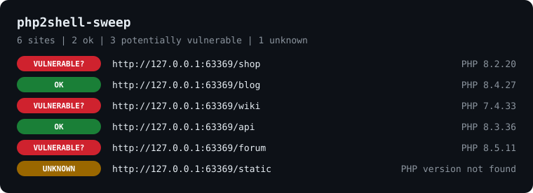

<div align="center">

# php2shell-sweep

**Find out which of your websites still need the PHP2Shell patch, all at once, in one picture.**

PHP2Shell (CVE-2026-109618 / CVE-2026-109619) is this week's PHP emergency. OpenAI's checker answers for one URL; this one sweeps your whole site list in parallel with the same verdicts and sends zero exploit bytes.

Works with **Claude Code** and **Codex**.

 



<sub>Real output of <code>python sweep.py --demo --svg docs/demo.svg</code> (six fake sites served on localhost).</sub>

</div>

## Quick start
```bash
git clone https://github.com/Dodai0419/php2shell-sweep && cd php2shell-sweep
python sweep.py -l examples/sites.txt -o results.json --svg results.svg
```
Python 3.9+ standard library only. Nothing to install.
```text
https://shop.example.com     POTENTIALLY VULNERABLE: PHP 8.2.20: Potentially vulnerable. HTTP headers cannot tell whether this version contains a backported fix.
https://blog.example.com     OK: PHP 8.4.27: advertised version meets an upstream fixed release. Installed build not verified.
https://static.example.com   UNKNOWN: PHP version not found

3 sites: 1 ok, 1 potentially vulnerable, 1 unknown
```
(The text above shows the output format. Try `python sweep.py --demo` to see a real run without touching the network.)

## The problem
- Five PHP2Shell repos hit GitHub's top 50 this week, but the safe checker takes **one URL per run**. Agencies and hosts have dozens.
- The full scanners send **~29 MiB of crafted probes per path** to crash PHP on purpose. You do not want that against production, or against a site you are only asked to inventory.
- A wall of terminal lines is hard to forward to a manager or a client.

## The solution
| Idea | Fixes |
|------|-------|
| **Same verdict rules as openai/php2shell-checker** (fixed in 8.2.35 / 8.3.36 / 8.4.27 / 8.5.12; 5.4-8.1 always flagged; prerelease = unknown; worst banner wins) | No new false OKs: every upstream test vector is ported into `tests/` |
| **Host list + 20 threads** (`-l sites.txt -t 20`, duplicates removed, `#` comments allowed) | 50 slow sites in about 1.5 s instead of about 6.5 s one by one |
| **Headers only** (HEAD, GET only on 405/501, no redirects, no body read) | Safe to run against production; nothing that looks like an attack |
| **`--svg` picture and `-o` JSON** | One image to paste into a ticket, one file for scripts |

## Use with Claude Code
```bash
/plugin marketplace add Dodai0419/php2shell-sweep
/plugin install php2shell-sweep@php2shell-sweep
```
Then ask: *"Check every domain in sites.txt for php2shell and give me the picture."*

## Use with Codex (ChatGPT)
```bash
git clone https://github.com/Dodai0419/php2shell-sweep && cp -r php2shell-sweep/skills/* ~/.codex/skills/
```
Or copy `AGENTS.md` into your project root.

## Gallery

**1. Sweep a list and get a picture** (`--svg`)
```bash
python sweep.py -l examples/sites.txt --svg results.svg
```
Red pill = potentially vulnerable, green = OK, amber = unknown. See the image at the top.

**2. Machine-readable, one object per site** (`--json`)
```json
{"url": "http://127.0.0.1:63369/shop", "patch_status": "potentially_vulnerable", "reason": "PHP 8.2.20: Potentially vulnerable. HTTP headers cannot tell whether this version contains a backported fix.", "php_version": "8.2.20", "exit_code": 1}
```

**3. Conflicting headers: the warning wins**
`Server: Apache/2.4.62 PHP/8.4.27` plus `X-Powered-By: PHP/8.1.35` gives `POTENTIALLY VULNERABLE: PHP 8.1.35`, same as upstream (tested in `test_conflicting_headers`).

**4. Distro builds**
`PHP/8.4.26-1ubuntu1` is flagged, `PHP/8.4.27-1ubuntu1` is OK, `PHP/8.4.27RC1` is UNKNOWN.

**5. Use it as a CI or cron gate**
```bash
python sweep.py -l sites.txt -o results.json || echo "patch needed"
```
Exit code is the worst status: 1 if any site is flagged, 0 if the rest are OK, 3 only if every site was unknown, 2 for bad arguments.

## Benchmarks
| | openai/php2shell-checker | assetnote/php2shell-scanner | this repo |
|-|-|-|-|
| 50 sites, 100 ms server delay | not measured (one URL per run) | not measured (sends probes) | **1.36-1.85 s** with `-t 20`; 6.35-6.67 s with `-t 1` |
| lines of code (checker script) | 99 (JS) | 1,320 (Python) | 189 (Python, incl. SVG report and demo) |
| runtime dependencies | Node 20+ | h11, tqdm | none (Python stdlib) |
| exploit traffic per path | none | up to ~29 MiB | none |

Command: `python bench/bench.py 50 100` (3 runs). Windows 11, Python 3.11.1, local fake sites on 127.0.0.1. The upstream checkers were not executed in this run, so their latency is "not measured"; the LOC and dependency numbers come from their source files.

## Inspired by
- [openai/php2shell-checker](https://github.com/openai/php2shell-checker) — the version verdict rules, reason texts, exit codes and test vectors (Apache-2.0).
- [assetnote/php2shell-scanner](https://github.com/assetnote/php2shell-scanner) — host lists, de-duplication, thread pool and JSON results file (MIT). The crash probes were left out on purpose.

## Roadmap
- [ ] `--server` mode: read the installed package version (dpkg / rpm) and compare with the vendor advisory tables.
- [ ] HTML report with per-site advice.
- [ ] Read targets from a sitemap or a Caddy / nginx config.

## License
MIT. Verdict rules adapted from openai/php2shell-checker (Apache-2.0); see LICENSE.
